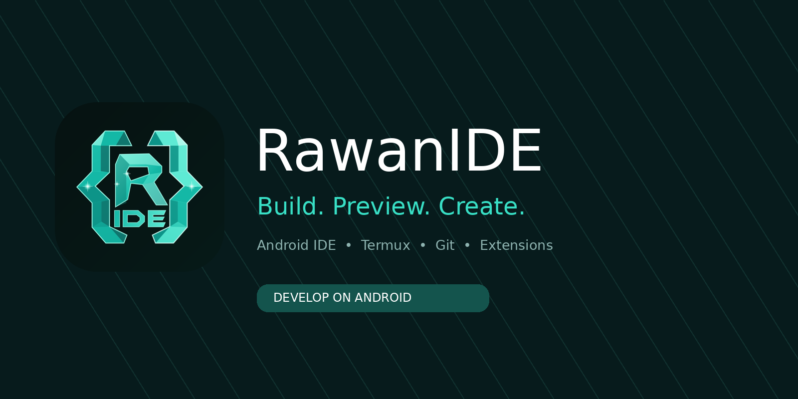
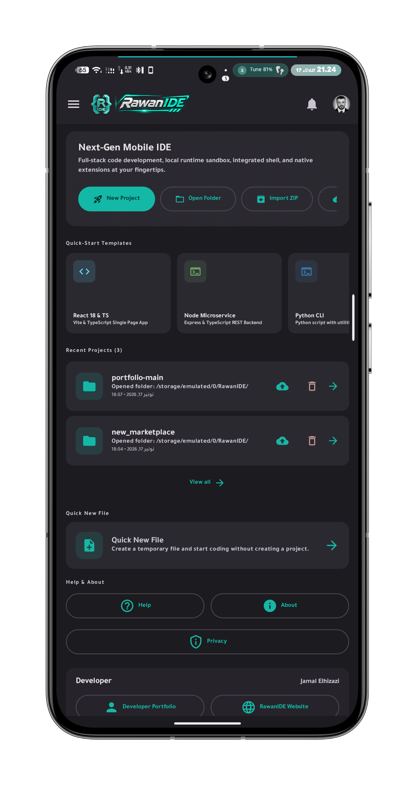
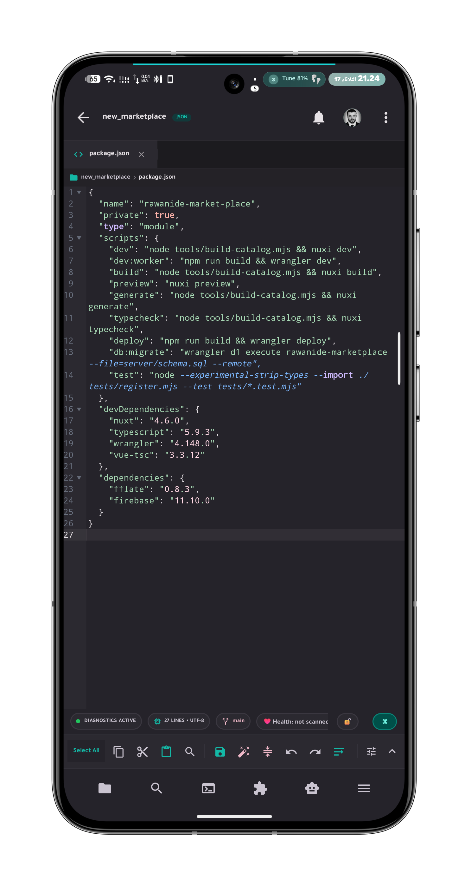
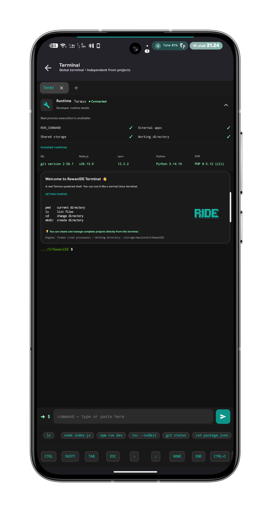
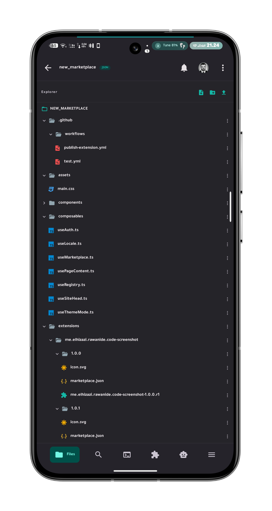
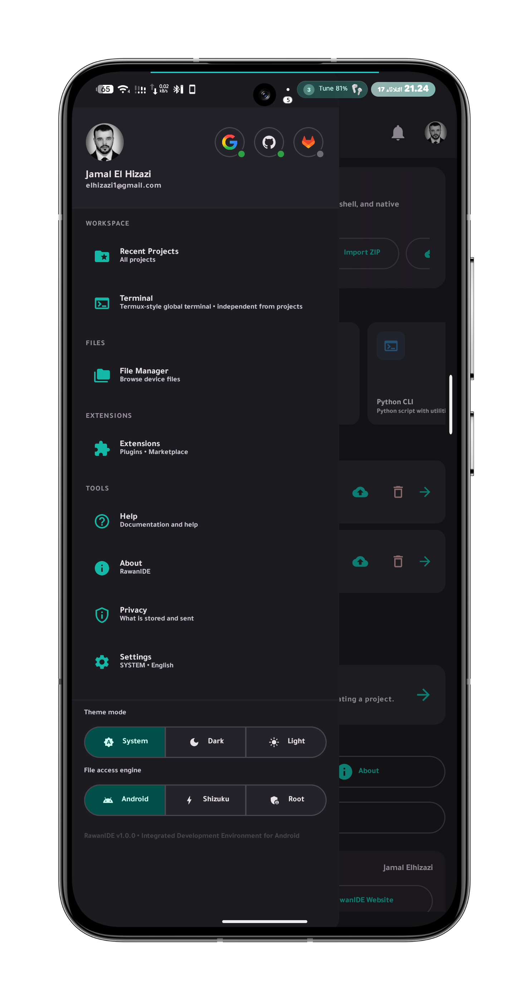
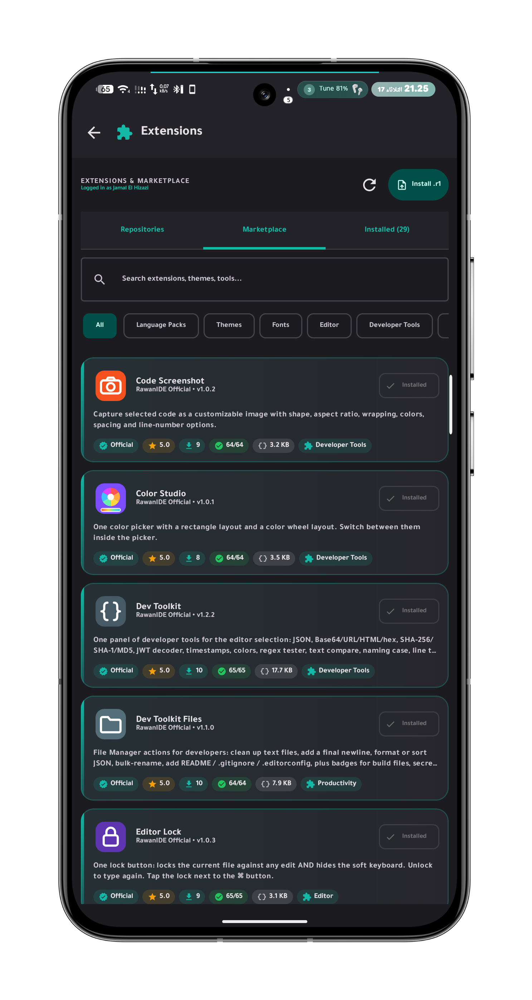

<div align="center">

<a href="https://rawanide.elhizazi.me"></a>

# RawanIDE — روان IDE

### أندرويد الخاص بك. مساحة عملك. بيئة تطويرك.

**أنشئ المشاريع وحرّرها وشغّلها وعاينها مباشرةً من أندرويد.**


<p>
<a href="https://github.com/elhizazi1/RawanIDE/releases/latest"></a>


<a href="https://github.com/elhizazi1/rawanide-extension-sdk"></a>
</p>

**[تنزيل APK](https://github.com/elhizazi1/RawanIDE/releases/latest)** · **[مركز المساعدة](https://rawanide.elhizazi.me/help)** · **[SDK الإضافات](https://github.com/elhizazi1/rawanide-extension-sdk)** · **[English](README.md)**



</div>

---

## ✨ طوّر على أندرويد بطريقتك

يجمع RawanIDE **إدارة المشاريع وتحرير الشيفرة والتطوير بمساعدة الطرفية والمعاينة المدمجة** في مساحة عمل واحدة على هاتفك أو جهازك اللوحي. يمكنك التعامل مع الملفات المحلية واستعراض الشيفرة واختبار مشاريع الويب المدعومة دون التنقل المستمر بين التطبيقات.

<table>
<tr><td width="50%" valign="top">

### 📁 مساحة عمل المشاريع
إنشاء مجلدات المشاريع المحلية واستيرادها وتصفحها وتنظيم الملفات المصدرية.

</td><td width="50%" valign="top">

### ✍️ تحرير الشيفرة
تحرير ملفات المصدر والتنقل في بنية المشروع داخل بيئة التطوير.

</td></tr>
<tr><td valign="top">

### 💻 تكامل Termux
تشغيل أوامر التطوير والخوادم المحلية المدعومة عبر بيئة Termux المهيأة.

</td><td valign="top">

### 🌐 معاينة الويب المباشرة
معاينة المشاريع المخدومة محليًا داخل Android WebView، بما فيها سير عمل Vite وNuxt المدعوم.

</td></tr>
<tr><td valign="top">

### 📱 اختبار الواجهات المتجاوبة
التبديل بين معاينة الهاتف واللوحي وسطح المكتب، مع لوحة لمس وإعدادات المؤشر لسطح المكتب.

</td><td valign="top">

### 🛠 أدوات المطور
فحص المعاينة باستخدام أدوات Console وEruda للتصحيح.

</td></tr>
<tr><td valign="top">

### 🌿 سير عمل Git
التعامل مع المستودعات وعمليات التحكم بالإصدارات المدعومة.

</td><td valign="top">

### 🧩 قابل للتوسعة
استكشاف الإضافات الاختيارية وحزم اللغات عبر RawanIDE Marketplace.

</td></tr>
</table>

> [!NOTE]
> تعتمد بعض الوظائف على تثبيت Termux منفصلًا أو اعتماديات المشروع أو الصلاحيات أو الخدمات الاختيارية أو الإضافات. تكاملا Shizuku وDhizuku اختياريان، ولا يلزمان للتحرير الأساسي.

## 🔍 الميزات بالتفصيل

يعرض الجدول إمكانات التطبيق وتكاملاته المدعومة. وقد يختلف توفرها حسب نسخة التطبيق وإصدار Android والإعدادات والمكونات الاختيارية.

| المجال | الإمكانات |
| :-- | :-- |
| **المشاريع والملفات** | إنشاء المشاريع المحلية واستيرادها وتصفحها؛ إدارة الملفات والمجلدات؛ إظهار تنبيه أمني عند فتح مشروع من موقع خارجي. |
| **محرر الشيفرة** | تحرير ملفات المصدر وحفظ التغييرات؛ النسخ الاحتياطي بصيغة `.bak` والاستعادة؛ التشخيصات والتكامل الاختياري مع أدوات اللغات. |
| **الطرفية وNode.js** | تشغيل الأوامر عبر Termux، وتثبيت اعتماديات المشاريع باستخدام `npm install`، وتشغيل سكربتات التطوير مثل `npm run dev`. تتوفر Node.js وnpm عبر بيئة Termux المهيأة، **وليستا ضمن حزمة Extension SDK**. |
| **تطوير الويب** | تشغيل خوادم التطوير المحلية للمشاريع المدعومة مثل Vite/React وNuxt مع المعاينة داخل التطبيق. |
| **المعاينة المتجاوبة** | أوضاع الهاتف واللوحي وسطح المكتب؛ لوحة لمس سطح المكتب؛ إعدادات مظهر المؤشر والتحكم به. |
| **تصحيح المعاينة** | لوحة Console مع خيارات التحديد والنسخ والمسح، وأداة Eruda في السياقات المدعومة. |
| **أدوات التطوير** | سير عمل Git؛ تكامل اختياري مع LSP/DAP يتطلب إعداد خوادم لغات أو محولات تصحيح منفصلة. |
| **الإضافات واللغات** | تصفح Marketplace وتثبيت إضافات `.r1` وحزم لغات اختيارية وميزات تقدمها الإضافات. |
| **سلامة الإضافات** | فحص بيانات الحزم وسلامتها، وضوابط الثقة، وإعدادات موجهة للمطورين؛ يعتمد التنفيذ الدقيق على إصدار التطبيق وإعداد المستودع. |
| **الواجهة والأدوات** | السمتان الفاتحة والداكنة، ومركز الإشعارات، وإعدادات المشاريع والطرفية، وتكامل Shizuku/Dhizuku الاختياري للعمليات المدعومة. |

> [!NOTE]
> هذا وصف عام، وليس ضمانًا بأن جميع الميزات التجريبية أو الاختيارية مفعلة في إصدار APK العام. راجع ملاحظات كل إصدار لمعرفة المتاح فيه.

## 📸 استكشف RawanIDE

<div align="center">
<table>
<tr><td align="center"><br /><strong>المشاريع</strong></td><td align="center"><br /><strong>المحرر</strong></td><td align="center"><br /><strong>الطرفية</strong></td></tr>
<tr><td align="center"><br /><strong>المعاينة المباشرة</strong></td><td align="center"><br /><strong>Git</strong></td><td align="center"><br /><strong>Marketplace</strong></td></tr>
</table>
</div>

## 🚀 تنزيل التطبيق وتثبيته

1. افتح **[صفحة أحدث إصدار على GitHub](https://github.com/elhizazi1/RawanIDE/releases/latest)**.
2. نزّل **`RawanIDE-release-signed.apk`** من ملفات الإصدار.
3. قارن بصمة SHA-256 الخاصة بـAPK مع البصمة المنشورة للإصدار، إن توفرت.
4. ثبّت APK على جهاز Android متوافق، ووافق على مطالبة التثبيت عند الحاجة.
5. افتح RawanIDE وهيئ الوظائف التي تريد استخدامها.

**التوافق:** Android 8.0 (API 26) أو أحدث. قد تتطلب التكاملات وأدوات التطوير الاختيارية شروطًا إضافية.

> [!IMPORTANT]
> نزّل ملفات APK فقط من الإصدارات المنشورة في هذا المستودع. راجع الصلاحيات ومدى موثوقية الإضافات قبل تثبيتها.

## ⚡ البدء السريع

```text
1. افتح RawanIDE
2. أنشئ مشروعًا أو استورد مشروعًا
3. افتح المحرر وتصفح ملفاتك
4. هيئ Termux إذا كان المشروع يحتاج إلى خادم محلي
5. ثبّت اعتماديات المشروع وشغّل خادم التطوير
6. افتح المعاينة المباشرة واختر وضع الهاتف أو اللوحي أو سطح المكتب
```

للتعليمات الكاملة، راجع **[مركز المساعدة](https://rawanide.elhizazi.me/help)**.

## 🧰 الأدوات والتكاملات

| المكون | الوظيفة | المتطلبات |
| :-- | :-- | :-- |
| Android WebView | معاينة الويب المدمجة | التطبيق / WebView الموجود على الجهاز |
| Termux | أوامر التطوير والخوادم المحلية | إعداد منفصل عند الحاجة |
| Eruda | تصحيح صفحات الويب | متاح في سياقات المعاينة المدعومة |
| Git | سير العمل مع المستودعات | بحسب إعداد المشروع والميزات المدعومة |
| Shizuku / Dhizuku | تكاملات اختيارية ذات صلاحيات خاصة | فقط للميزات التي تستخدمها |
| RawanIDE Marketplace | إضافات وحزم لغات | اختياري |

## 🧩 منظومة RawanIDE للمطورين

**هذا المستودع مخصص لتطبيق RawanIDE على Android بصيغة APK ومعلومات إصداراته.** موارد المطورين أدناه مشاريع منفصلة؛ حزمة SDK على npm **ليست تطبيق Android**.

| المشروع | الغرض | الرابط |
| :-- | :-- | :-- |
| **تطبيق RawanIDE** | تنزيل بيئة التطوير وتثبيتها بصيغة APK | [إصدارات APK](https://github.com/elhizazi1/RawanIDE/releases/latest) |
| **Extension SDK** | إنشاء إضافات `.r1` وفحصها وتجهيز حزمها | [شيفرة GitHub](https://github.com/elhizazi1/rawanide-extension-sdk) · [حزمة npm](https://www.npmjs.com/package/@elhizazi1/extension-sdk) |
| **RawanIDE Marketplace** | استكشاف الإضافات الاختيارية وحزم اللغات وإدارتها داخل RawanIDE | [موقع RawanIDE](https://rawanide.elhizazi.me/) |
| **قالب مستودع المجتمع** | نقطة انطلاق لإنشاء مستودع إضافات مجتمعي | [قالب GitHub](https://github.com/elhizazi1/rawanide-community-repository-template) |
| **مستودع مجتمع على GitHub (مثال حي)** | مثال لمستودع إضافات مجتمعي مستضاف على GitHub | [المستودع المصدري](https://github.com/elhizazi1/jamal-repository) · [الموقع المنشور](https://elhizazi1.github.io/jamal-repository/) |
| **مستودع مجتمع على GitLab (مثال حي)** | مثال لمستودع إضافات مجتمعي مستضاف على GitLab | [المستودع المصدري](https://gitlab.com/elhizazi1/jamal-repository) · [الموقع المنشور](https://jamal-repository-5d923d.gitlab.io/) |

### تثبيت Extension SDK (للمطورين فقط)

```bash
npm install @elhizazi1/extension-sdk
```

يثبّت هذا الأمر **SDK داخل مشروع Node.js**، ولا يثبّت تطبيق RawanIDE على Android. لتثبيت التطبيق نزّل **APK** من صفحة إصدارات هذا المستودع. راجع [مستودع SDK](https://github.com/elhizazi1/rawanide-extension-sdk) لتعليمات الاستخدام والتوافق. وتظل المستودعات المجتمعية وإضافاتها خاضعة لقواعد التحقق والثقة في Marketplace.

## 📚 التوثيق والمجتمع

| المورد | الرابط |
| :-- | :-- |
| 📖 مركز المساعدة | [قراءة الدليل](https://rawanide.elhizazi.me/help) |
| ℹ️ حول التطبيق | [حول RawanIDE](https://rawanide.elhizazi.me/about) |
| 🔐 سياسة الخصوصية | [الخصوصية](https://rawanide.elhizazi.me/privacy) |
| 🧩 Marketplace | [استكشاف الإضافات](https://rawanide.elhizazi.me/) |
| 📦 الإصدارات | [تنزيل الإصدارات](https://github.com/elhizazi1/RawanIDE/releases) |
| 🐞 المشكلات | [الإبلاغ عن مشكلة](https://github.com/elhizazi1/RawanIDE/issues) |
| 🛠 Extension SDK | [GitHub](https://github.com/elhizazi1/rawanide-extension-sdk) · [npmjs](https://www.npmjs.com/package/@elhizazi1/extension-sdk) |
| 🧱 قالب مستودع المجتمع | [GitHub](https://github.com/elhizazi1/rawanide-community-repository-template) |
| 🌍 README الإنجليزي | [README.md](README.md) |

## 🤝 المساهمة والملاحظات

نرحب ببلاغات الأخطاء والملاحظات البناءة والمساهمات. اقرأ **[CONTRIBUTING.md](CONTRIBUTING.md)** وافتح بلاغًا يوضح إصدار Android وإصدار RawanIDE وخطوات إعادة المشكلة والسجلات المناسبة بعد حذف المعلومات الحساسة.

للمشكلات الأمنية الحساسة، راجع **[SECURITY.md](SECURITY.md)** قبل نشر التفاصيل علنًا.

## 🔒 الخصوصية والأمان

يتعامل RawanIDE مع ملفات المشاريع المحلية. قد تطلب الإضافات أو التكاملات الاختيارية وصولًا إضافيًا أو تتصل بخدمات خارجية. راجع [سياسة الخصوصية](https://rawanide.elhizazi.me/privacy)، ولا تمنح إلا الصلاحيات التي تحتاجها، ولا تشارك بيانات الدخول أو ملفات المشاريع الخاصة في بلاغات المشكلات.

## حقوق التأليف والتوزيع

حقوق التأليف © 2026 جمال الحزازي. جميع الحقوق محفوظة. ينشر هذا المستودع معلومات التطبيق وملفات إصداراته، وليس المستودع الكامل للشيفرة المصدرية لتطبيق Android. لحزمة Extension SDK المستقلة ترخيصها وشروط توزيعها الخاصة، وتبقى حقوق المكونات الخارجية وتراخيصها لأصحابها.

---

<div align="center">

**صُمم للمبدعين الذين يطورون على Android.**

<sub>RawanIDE · Code. Build. Preview. Anywhere.</sub>

<a href="https://github.com/elhizazi1/RawanIDE/releases/latest">تنزيل</a> · <a href="https://rawanide.elhizazi.me/help">التوثيق</a> · <a href="https://github.com/elhizazi1/RawanIDE/issues">الملاحظات</a>

</div>
