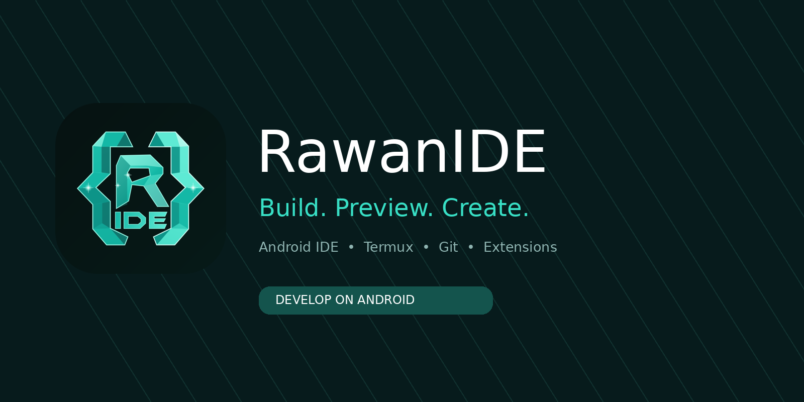
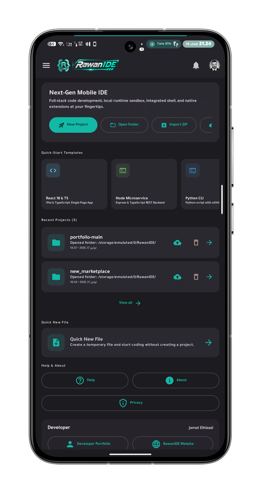
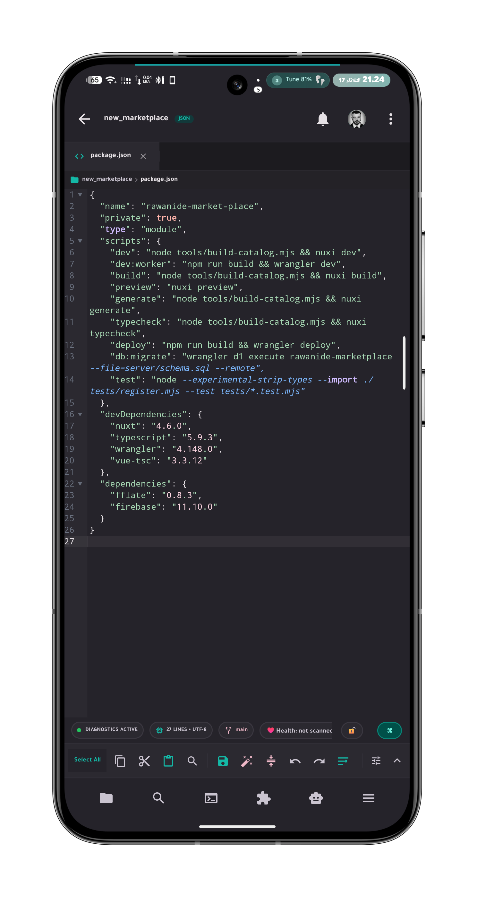
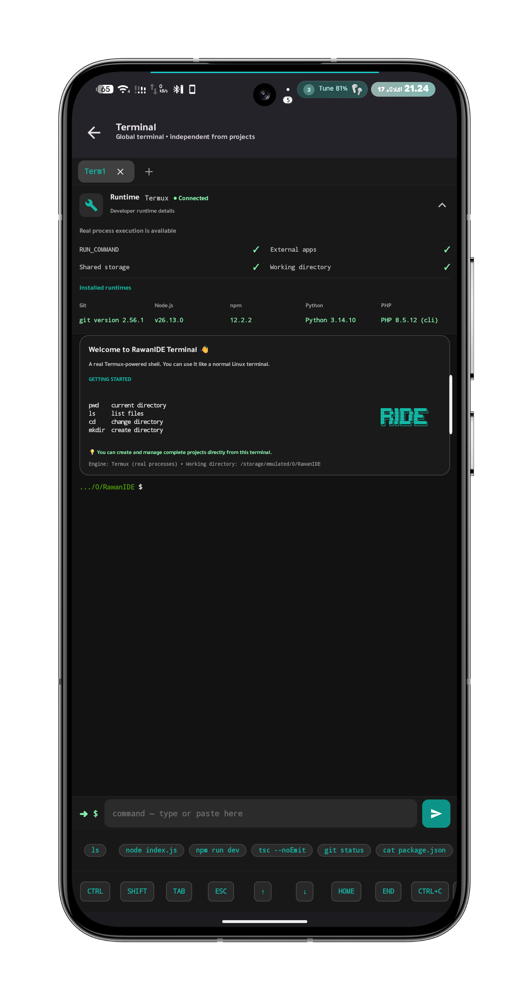
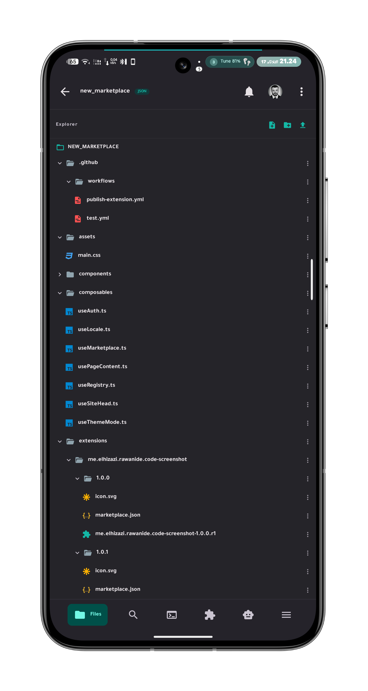
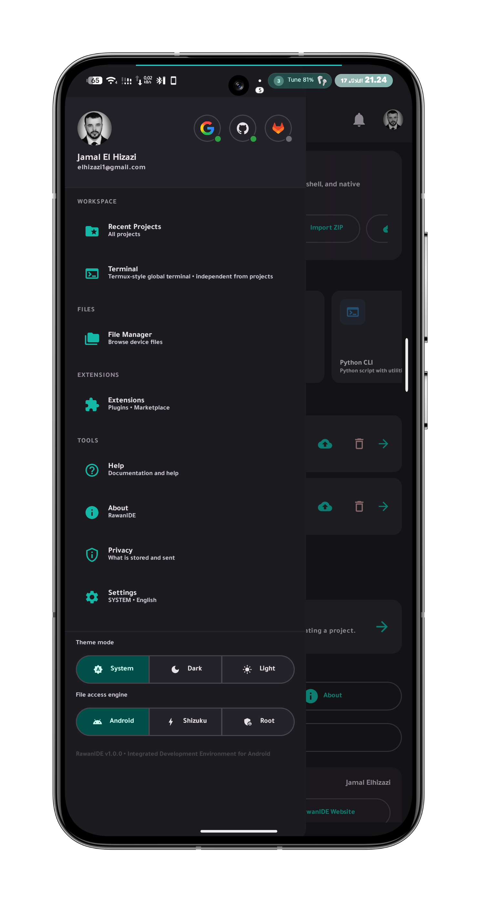
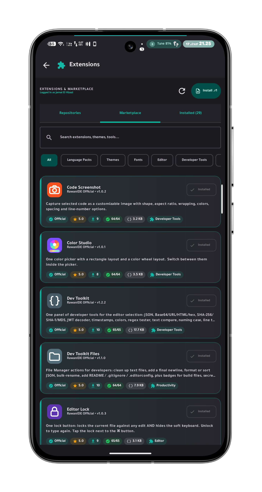

<div align="center">

<a href="https://rawanide.elhizazi.me"></a>

# RawanIDE

### Your Android. Your Workspace. Your IDE.

**Build, edit, run, and preview projects — right from Android.**


<p>
<a href="https://github.com/elhizazi1/RawanIDE/releases/latest"></a>


<a href="https://github.com/elhizazi1/rawanide-extension-sdk"></a>
</p>

**[Download APK](https://github.com/elhizazi1/RawanIDE/releases/latest)** · **[Help Center](https://rawanide.elhizazi.me/help)** · **[Extension SDK](https://github.com/elhizazi1/rawanide-extension-sdk)** · **[العربية](README.ar.md)**



</div>

---

## ✨ Develop on Android, your way

RawanIDE brings **project navigation, code editing, terminal-assisted development, and an integrated browser preview** into a single workspace on your phone or tablet. Work with local files, explore your code, and test supported web projects without constantly switching between apps.

<table>
<tr>
<td width="50%" valign="top">

### 📁 Project workspace
Create, import, browse, and organize local project folders and source files.

</td>
<td width="50%" valign="top">

### ✍️ Code editing
Edit source files and navigate project structures from the IDE.

</td>
</tr>
<tr>
<td valign="top">

### 💻 Termux integration
Run supported development commands and local servers through a configured Termux environment.

</td>
<td valign="top">

### 🌐 Live web preview
Preview locally served projects in an embedded Android WebView, including supported Vite and Nuxt workflows.

</td>
</tr>
<tr>
<td valign="top">

### 📱 Responsive testing
Switch between phone, tablet, and desktop preview layouts, with a desktop touchpad and cursor controls.

</td>
<td valign="top">

### 🛠 Developer tools
Inspect the preview using console features and Eruda debugging tools.

</td>
</tr>
<tr>
<td valign="top">

### 🌿 Git workflows
Work with repositories and supported version-control operations.

</td>
<td valign="top">

### 🧩 Extensible by design
Explore optional extensions and language packs through the RawanIDE Marketplace.

</td>
</tr>
</table>

> [!NOTE]
> Some workflows depend on separately installed Termux, project dependencies, permissions, optional services, or extensions. Shizuku and Dhizuku are optional integrations; they are not required for basic editing.

## 📸 Explore RawanIDE

<div align="center">
<table>
<tr><td align="center"><br /><strong>Projects</strong></td><td align="center"><br /><strong>Editor</strong></td><td align="center"><br /><strong>Terminal</strong></td></tr>
<tr><td align="center"><br /><strong>Live Preview</strong></td><td align="center"><br /><strong>Git</strong></td><td align="center"><br /><strong>Marketplace</strong></td></tr>
</table>
</div>

## 🚀 Download & install

1. Open the **[latest GitHub release](https://github.com/elhizazi1/RawanIDE/releases/latest)**.
2. Download **`RawanIDE-release-signed.apk`** from the release assets.
3. Compare the APK's SHA-256 checksum with the checksum published for that release, if available.
4. Install the APK on a compatible Android device, approving the installation prompt when required.
5. Open RawanIDE and configure the features you intend to use.

**Compatibility:** Android 8.0 (API 26) or later. Optional integrations and development tooling may have additional requirements.

> [!IMPORTANT]
> Download APKs only from releases published by this repository. Review permissions and the trustworthiness of any extensions you install.

## ⚡ Quick start

```text
1. Open RawanIDE
2. Create or import a project
3. Open the editor and browse your files
4. Configure Termux if your project needs a local server
5. Install project dependencies and start the development server
6. Open Live Preview and choose Phone, Tablet, or Desktop mode
```

For full setup instructions, visit the **[Help Center](https://rawanide.elhizazi.me/help)**.

## 🧰 Tools & integrations

| Component | Role | Requirement |
| :-- | :-- | :-- |
| Android WebView | Embedded web preview | Included in the app / device WebView |
| Termux | Local development commands and servers | Separate setup for relevant workflows |
| Eruda | Web debugging | Available in supported preview contexts |
| Git | Repository workflows | Feature support depends on the project setup |
| Shizuku / Dhizuku | Optional privileged integrations | Only for features that use them |
| RawanIDE Marketplace | Extensions and language packs | Optional |

## 🧩 Build extensions with the official SDK

Extend RawanIDE with `.r1` packages using the **[RawanIDE Extension SDK](https://github.com/elhizazi1/rawanide-extension-sdk)** — a separate developer toolkit for creating, validating, inspecting, and packaging extensions.

| Developer resource | Explore |
| :-- | :-- |
| 🛠 Extension SDK source | [rawanide-extension-sdk](https://github.com/elhizazi1/rawanide-extension-sdk) |
| 📦 Published package | [GitHub Packages](https://github.com/elhizazi1/rawanide-extension-sdk/packages) · `@elhizazi1/extension-sdk` |
| 📖 Developer documentation | [Developer portal](https://rawanide.elhizazi.me/developers) |

> [!TIP]
> The SDK is a **developer tool**, not an Android app dependency. It has its own releases and does not require modifying the RawanIDE application to create extension packages.

## 📚 Documentation & community

| Resource | Link |
| :-- | :-- |
| 📖 Help Center | [Read the guide](https://rawanide.elhizazi.me/help) |
| ℹ️ About | [About RawanIDE](https://rawanide.elhizazi.me/about) |
| 🔐 Privacy Policy | [Privacy](https://rawanide.elhizazi.me/privacy) |
| 🧩 Marketplace | [Explore extensions](https://rawanide.elhizazi.me/) |
| 📦 Releases | [Download versions](https://github.com/elhizazi1/RawanIDE/releases) |
| 🐞 Issues | [Report a problem](https://github.com/elhizazi1/RawanIDE/issues) |
| 🛠 Extension SDK | [Create .r1 extensions](https://github.com/elhizazi1/rawanide-extension-sdk) |
| 🌍 Arabic README | [README.ar.md](README.ar.md) |

## 🤝 Contributing & feedback

Contributions, bug reports, and constructive feedback are welcome. Read **[CONTRIBUTING.md](CONTRIBUTING.md)** and open an issue describing your Android version, RawanIDE version, reproduction steps, and relevant sanitized logs.

For security-sensitive findings, consult **[SECURITY.md](SECURITY.md)** before disclosing details publicly.

## 🔒 Privacy & security

RawanIDE works with local project files. Optional extensions or integrations may request additional access or communicate with external services. Review the [privacy policy](https://rawanide.elhizazi.me/privacy), grant only the permissions you need, and never share credentials or private project data in issue reports.

## ⚖️ License

Refer to the repository's **LICENSE** file if an official license has been published. This README does not establish or change the project's license.

---

<div align="center">

**Built for creators who develop on Android.**

<sub>RawanIDE · Code. Build. Preview. Anywhere.</sub>

<br /><br />

<a href="https://github.com/elhizazi1/RawanIDE/releases/latest">Download</a> · <a href="https://rawanide.elhizazi.me/help">Docs</a> · <a href="https://github.com/elhizazi1/RawanIDE/issues">Feedback</a>

</div>
