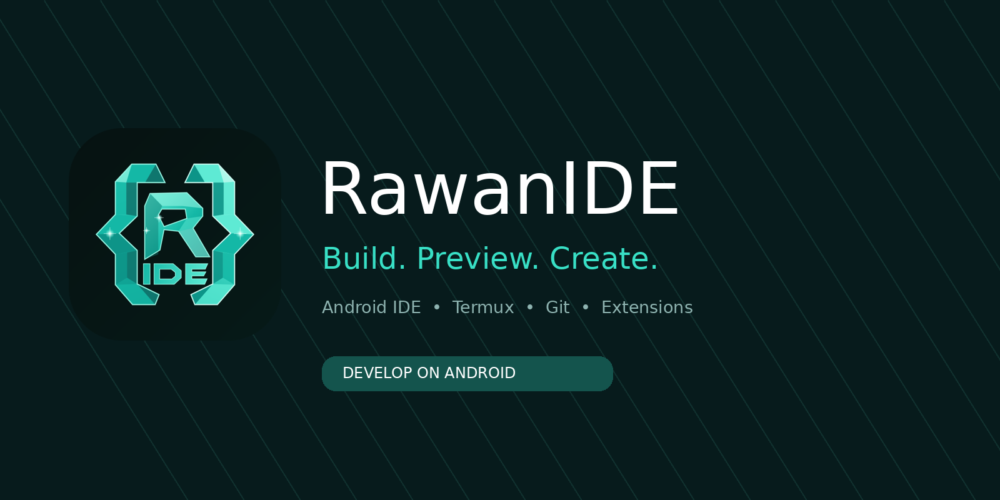

# RawanIDE

[Download latest release](https://github.com/elhizazi1/RawanIDE/releases/latest) · [Help](https://rawanide.elhizazi.me/help) · [Privacy](https://rawanide.elhizazi.me/privacy)

Develop locally on Android with a project manager, editor, terminal integration, embedded preview, Git tools, and an extension ecosystem.

**Visuals:** `preview_mockups/` contains concepts only, not real screenshots.
